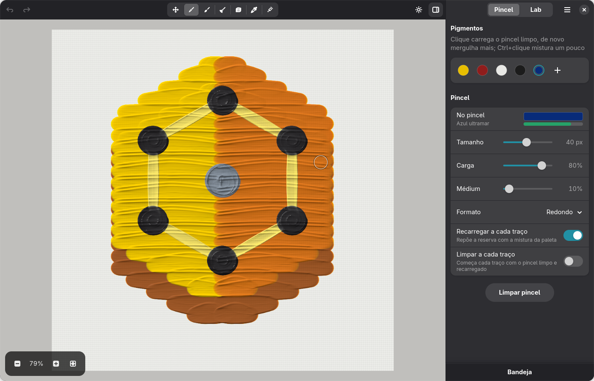
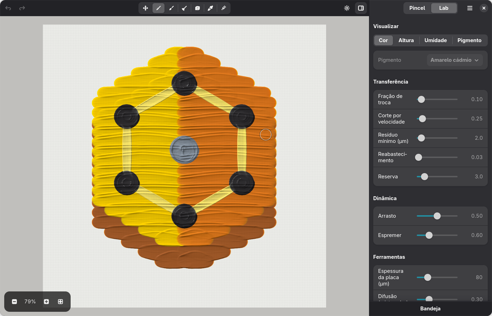

<p align="center">
  
</p>

<h1 align="center">Cadmium</h1>

<p align="center">Wet oil painting on the GPU, with pigments that mix like real paint.</p>

<p align="center">
  <a href="https://github.com/marcelogm/cadmium/actions/workflows/quality.yml"></a>
  <a href="https://github.com/marcelogm/cadmium/actions/workflows/quality.yml"></a>
  <a href="https://github.com/marcelogm/cadmium/releases/latest"></a>
  <a href="https://github.com/marcelogm/cadmium/actions/workflows/release.yml"></a>
  
  
  <a href="LICENSE"></a>
</p>



Paint stays wet on the canvas. The brush deposits, drags and mixes what is already there, the
palette knife lays thick slabs and carves grooves, and colours mix like pigments, not light:
each pigment is an absorption and scattering spectrum (Kubelka-Munk), simulated on the GPU.

- Brush, palette knife, blender and rag, shaped by pen pressure and tilt
- Twelve pigments, up to eight per painting, on linen, cotton or smooth canvas
- Paintings save wet, so you can pick up where you left off; export to PNG
- A Lab panel to look inside the simulation: height, wetness, pigment amounts, every parameter



## Install

Get a package from [Releases](https://github.com/marcelogm/cadmium/releases/latest), for
x86_64 or arm64. Every build needs a Vulkan GPU.

| Package | How |
|---|---|
| Flatpak | `flatpak install --user Cadmium-x86_64.flatpak` |
| AppImage | `chmod +x Cadmium-x86_64.AppImage`, then run it; works on any distro |
| Windows installer | Run `Cadmium-windows-x64-setup.exe` |
| Windows zip | Unzip anywhere and run `cadmium.exe` |

## Build

Needs GTK 4.22+, libadwaita 1.9+ and Rust 1.92+.

```sh
cargo run --release -p cadmium-app
```

Always build with `--release`; the debug build is too slow to paint with.

## Pen and mouse

| Input | Does |
|---|---|
| Pressure | Stroke size and how deep the brush sinks into wet paint |
| Tilt | Lays the brush on its side; tilts the knife to lay paint instead of scraping |
| Eraser end | Rag |
| Lower / upper side button | Eyedropper / pan |
| Middle / right mouse button | Pan / eyedropper |
| Scroll, pinch | Zoom (Shift+scroll pans) |

Press <kbd>Ctrl</kbd>+<kbd>?</kbd> in the app for every keyboard shortcut.

## Releasing

Bump `version` in `Cargo.toml` and add it to `<releases>` in the metainfo, then push a
`v<version>` tag. The Release workflow builds every package and publishes them.

## Notes

Pigment spectra are hand-tuned from each pigment's known look, not measured, so mixes are
plausible rather than exact. The brush is stamped along the stroke, not simulated bristle by
bristle.

## License

[MIT](LICENSE)
